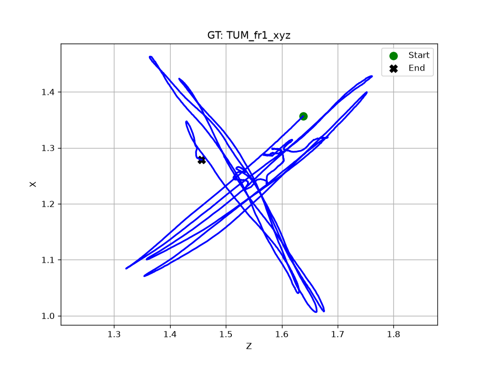
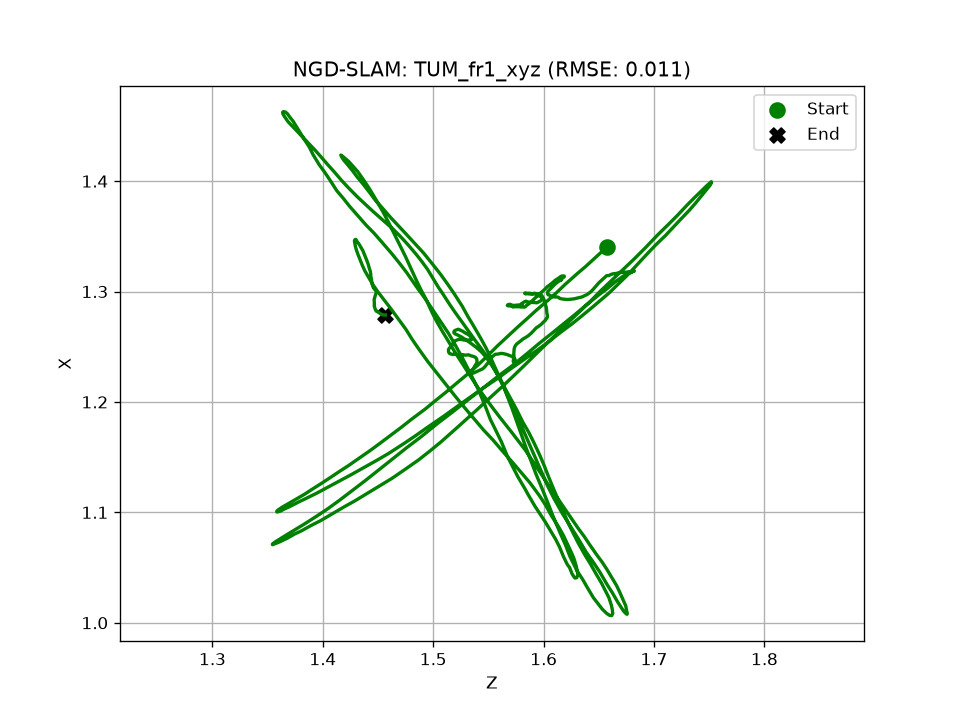
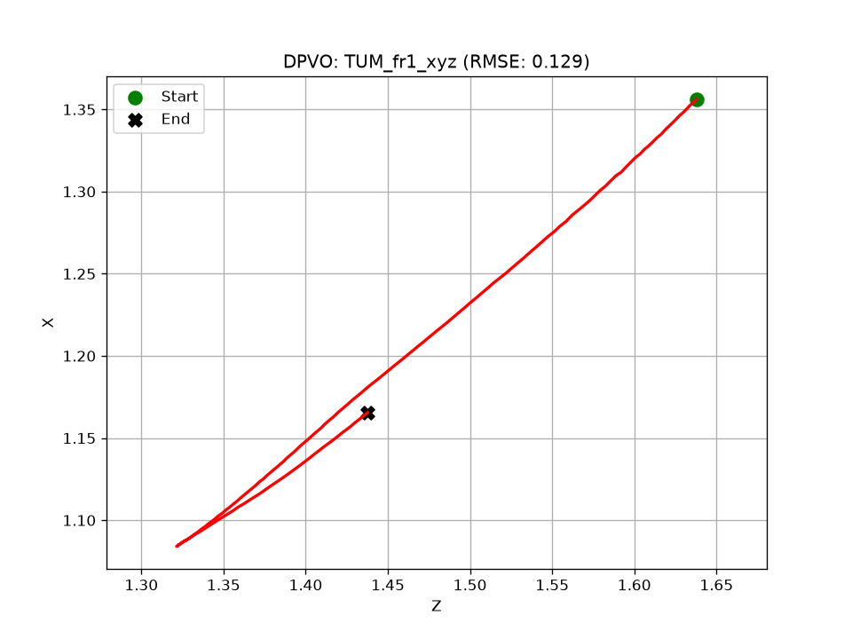
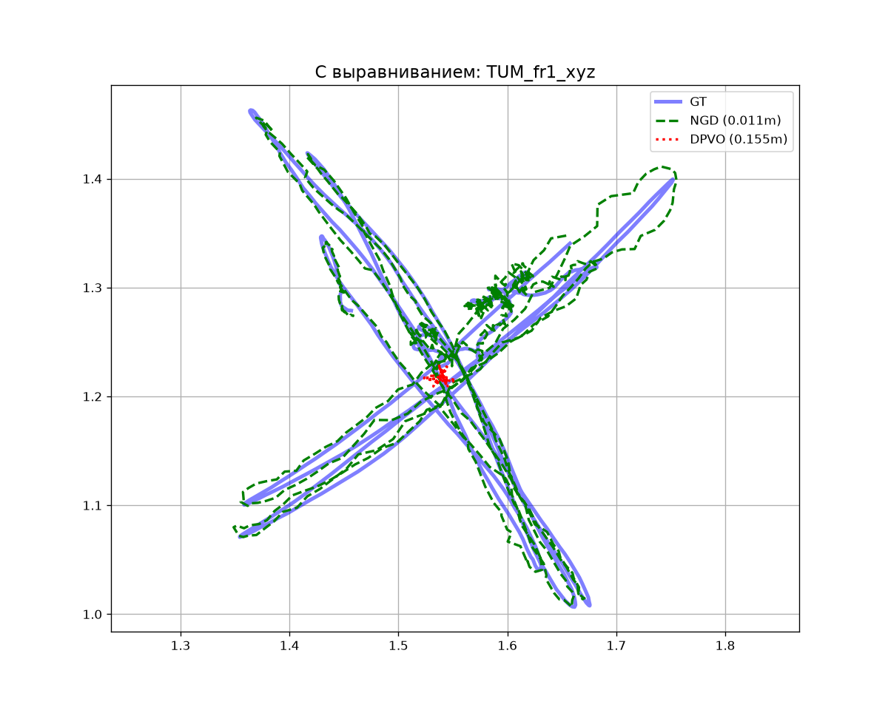

# TUM_fr1_xyz

## Численные метрики (ATE)

| Алгоритм | RMSE (м) | Средняя ошибка (м) | Макс. ошибка (м) | Пройдено пути (от GT) |
|---|---|---|---|---|
| **NGD-SLAM** | 0.0108 | 0.0093 | 0.0375 | 109.5% |
| **DPVO** | 0.1292 | 0.1116 | 0.2599 | 142.2% |

## Графики

