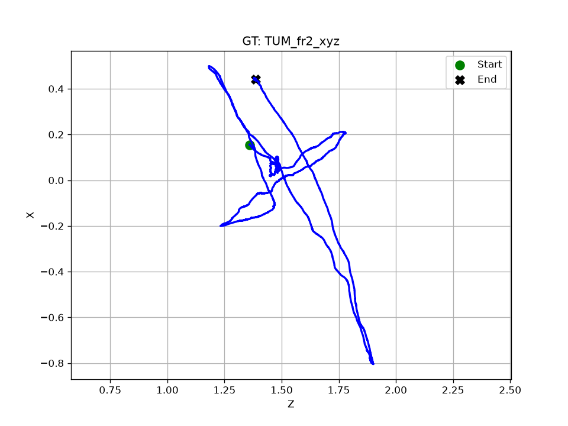
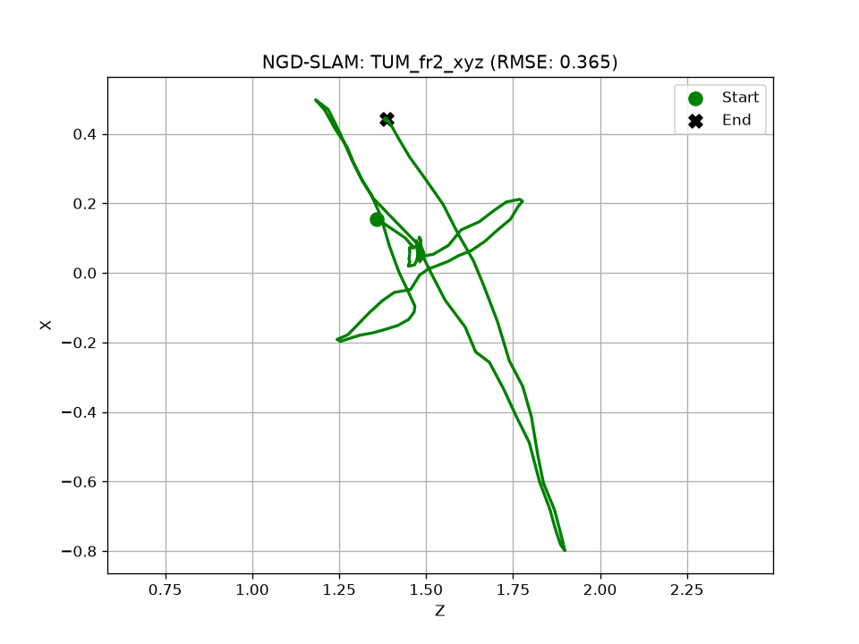
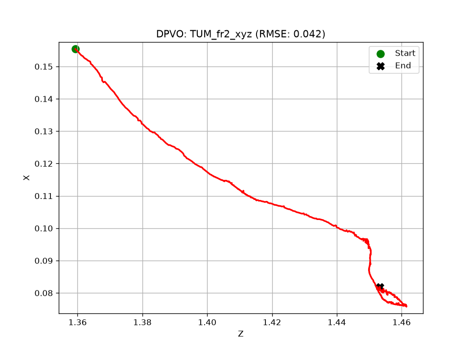
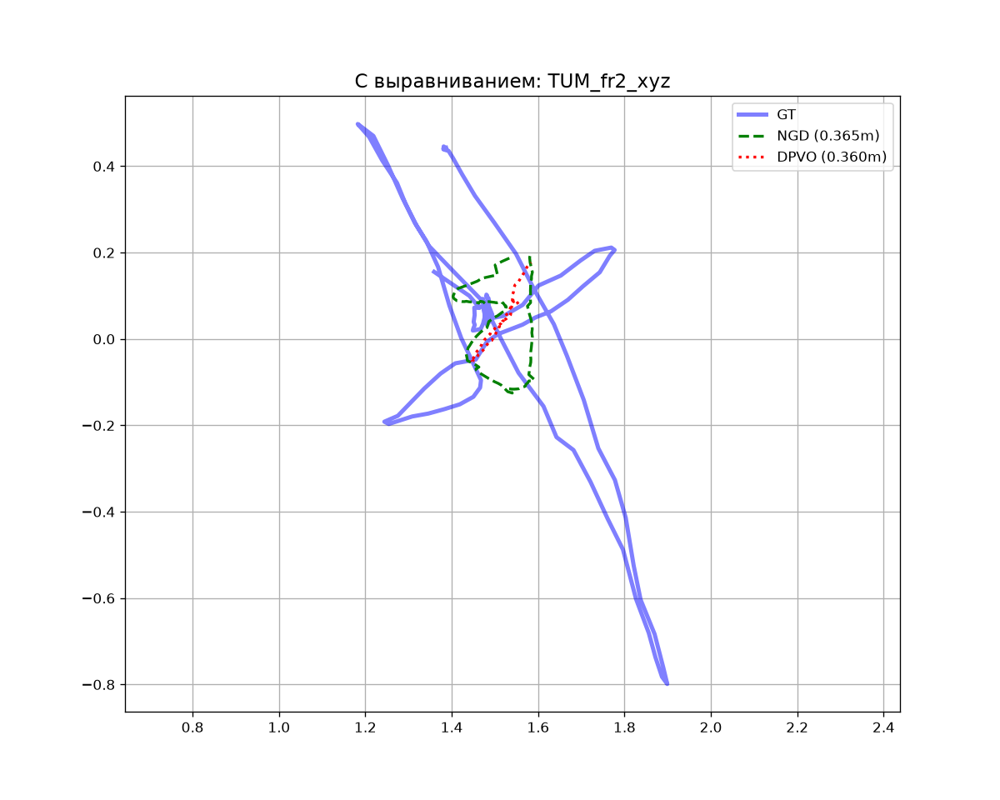

# TUM_fr2_xyz

## Численные метрики (ATE)

| Алгоритм | RMSE (м) | Средняя ошибка (м) | Макс. ошибка (м) | Пройдено пути (от GT) |
|---|---|---|---|---|
| **NGD-SLAM** | 0.3650 | 0.3153 | 0.8001 | 17.9% |
| **DPVO** | 0.0418 | 0.0371 | 0.0928 | 68.2% |

## Графики

