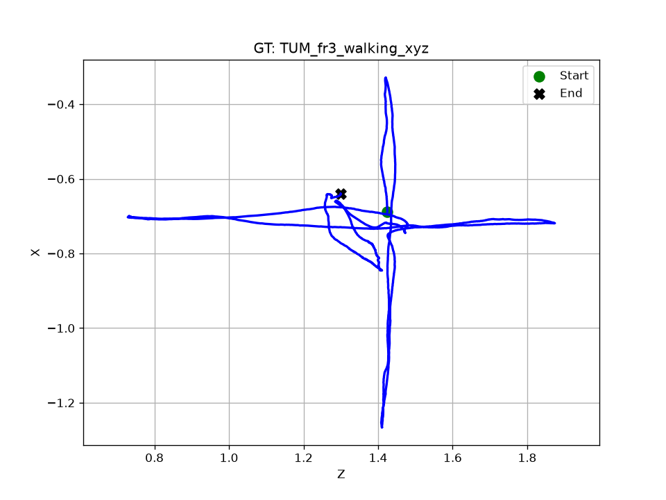
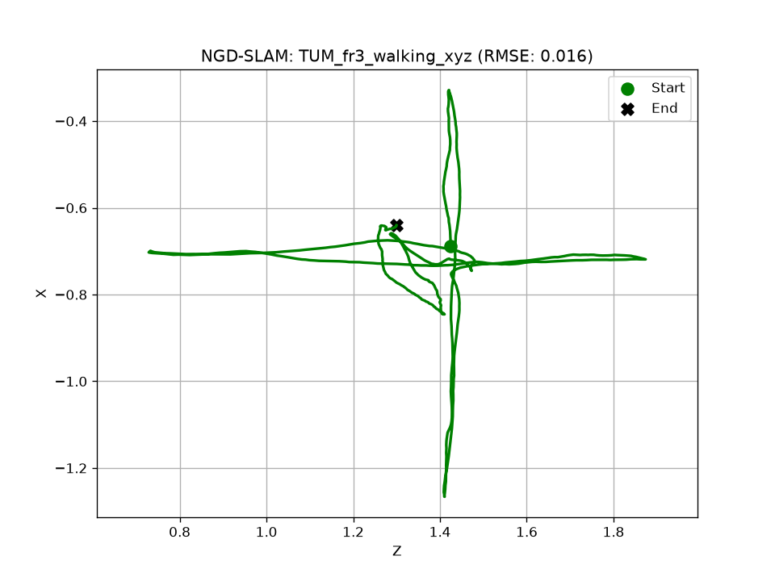
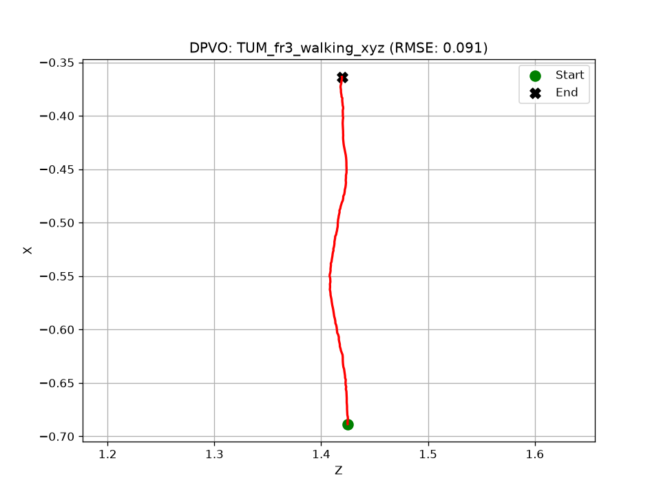
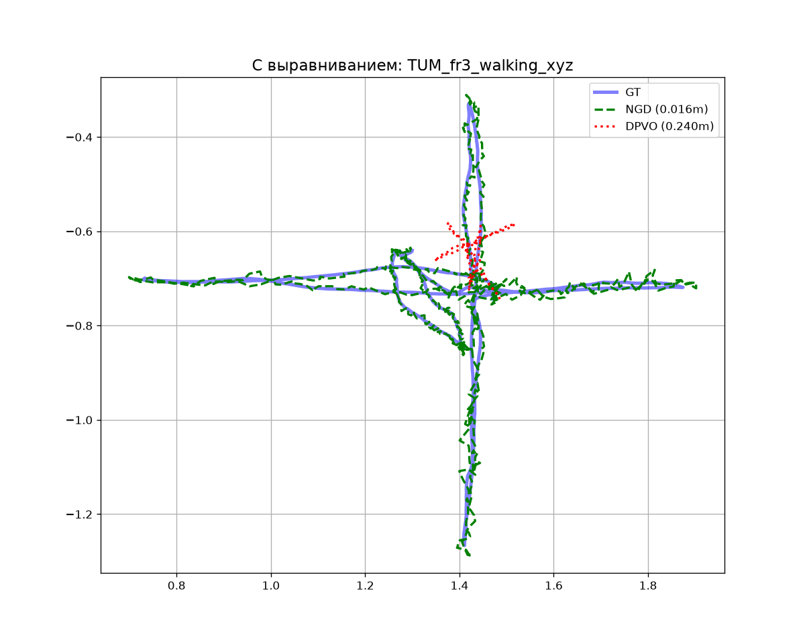

# TUM_fr3_walking_xyz

## Численные метрики (ATE)

| Алгоритм | RMSE (м) | Средняя ошибка (м) | Макс. ошибка (м) | Пройдено пути (от GT) |
|---|---|---|---|---|
| **NGD-SLAM** | 0.0156 | 0.0136 | 0.0486 | 158.9% |
| **DPVO** | 0.0909 | 0.0797 | 0.1534 | 202.9% |

## Графики

