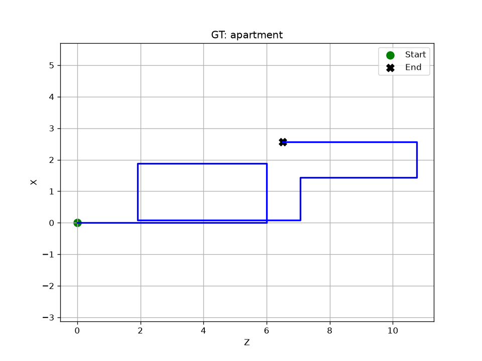
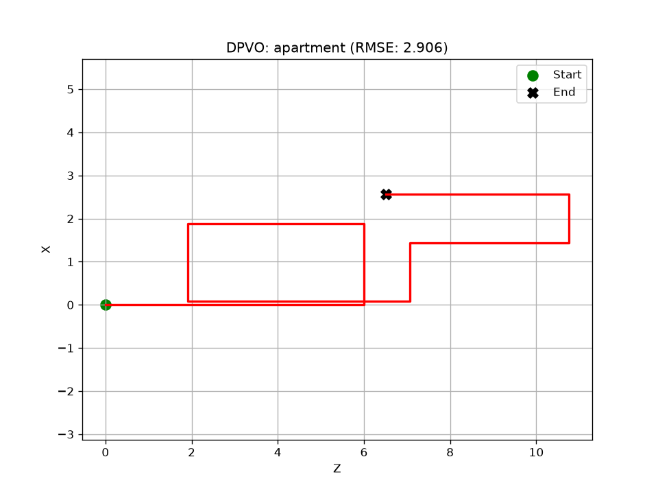
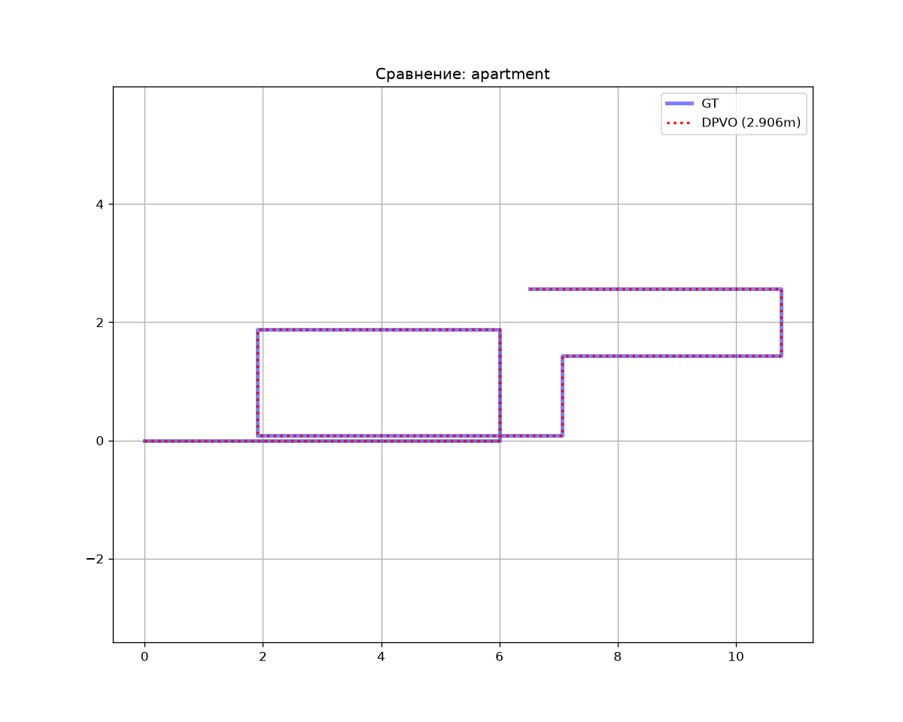

# apartment

## Численные метрики (ATE)

| Алгоритм | RMSE (м) | Средняя ошибка (м) | Макс. ошибка (м) | Пройдено пути (от GT) |
|---|---|---|---|---|
| **DPVO** | 2.9065 | 2.6275 | 4.6028 | 24.1% |

## Графики

